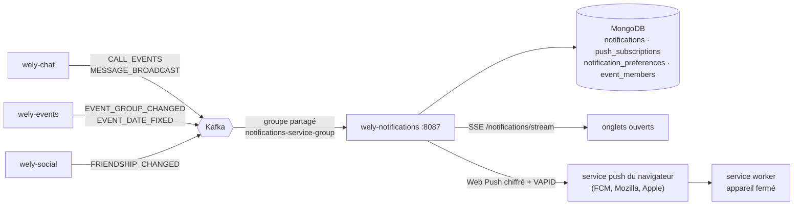

# wely-notifications

Service **centre de notifications et Web Push** de la plateforme [Wely Calendar](https://github.com/WelyLabs/wely-platform).

Il écoute ce qui se passe ailleurs — un appel qui sonne, un message, la date d'une sortie fixée, une demande d'ami — et en fait des notifications : enregistrées dans le centre de chaque utilisateur, poussées en direct aux onglets ouverts, et envoyées en **Web Push** à ses appareils quand l'application est fermée.

---

## Rôle

| | |
|---|---|
| **Port** | 8087 |
| **Préfixe HTTP** | `/notifications-service` (la gateway route `/api/v1/notifications-service/**`) |
| **Persistance** | MongoDB `notifications_db` |
| **Entrées** | Kafka : `CALL_EVENTS`, `MESSAGE_BROADCAST`, `EVENT_GROUP_CHANGED`, `EVENT_DATE_FIXED`, `FRIENDSHIP_CHANGED` |
| **Sorties** | REST, flux SSE, Web Push (RFC 8030/8291/8292) |

---

## Stack

Java 25 · Spring Boot 4 · WebFlux · Spring Cloud Stream (Kafka) · MongoDB réactif · Spring Security (JWT Keycloak) · MapStruct · springdoc · JDK seule pour la cryptographie Web Push

---

## Pourquoi un service dédié

| | |
|---|---|
| **Un seul endroit pour « prévenir quelqu'un »** | Les appels et les messages vivent dans `wely-chat`, les sorties dans `wely-events`, les amis dans `wely-social`. Aucun ne devrait savoir ce qu'est un appareil, une clé VAPID ou une préférence de notification. Ils publient ce qui s'est passé ; ce service décide qui prévenir et comment. |
| **Découplé par Kafka** | Aucun service métier n'appelle `wely-notifications`. Il consomme les topics existants : s'il tombe, les autres continuent, et il reprend où son groupe de consommateurs s'était arrêté. |
| **Le push est un détail d'infrastructure** | Le domaine produit un `PushMessage` (titre, texte, tag, urgence, durée de vie) ; le chiffrement et la signature sont dans un adaptateur, derrière le port `PushSender`. |

---

## Architecture



```
                        ┌──────────────────────────────────────────────────────┐
  Kafka (octets) ──────▶│ infrastructure/messaging                             │
                        │   CallEvents · Messages · EventGroups · EventDates   │
                        │   Friendships consumers  →  NotificationDrafts (FR)  │
                        └──────────────────────┬───────────────────────────────┘
  REST / SSE ──────────▶ application/rest      │ Notification (brouillon)
                        ┌──────────────────────▼───────────────────────────────┐
                        │ domain/                                              │
                        │   services/ NotificationService · PushService        │
                        │             EventMembershipService       (POJO)      │
                        │   ports/    NotificationRepository · Subscription…   │
                        │             LiveNotifications · PushSender · …       │
                        └─────▲──────────────────▲───────────────────▲─────────┘
                              │                  │                   │
            ┌─────────────────┴───┐  ┌───────────┴──────────┐  ┌─────┴─────────────────┐
            │ infrastructure/     │  │ infrastructure/      │  │ infrastructure/push   │
            │ persistence (Mongo) │  │ realtime (Sinks)     │  │ WebPushAdapter        │
            └─────────────────────┘  └──────────────────────┘  │ WebPushEncryption     │
                                                               │ VapidSigner · P256    │
                                                               └───────────────────────┘
```

`NotificationService.notify` :

1. enregistre la notification, ou la **regroupe** avec la notification non lue de la même conversation ;
2. la pousse sur le flux SSE de son destinataire, suivie du nouveau compteur de non-lus ;
3. l'envoie en Web Push à chacun de ses appareils, si la catégorie est activée dans ses préférences.

Un échec de push est journalisé et n'empêche jamais l'enregistrement. Un appareil auquel le service push répond **404 ou 410** est oublié.

### Regroupement des messages

Un nouveau message dans une conversation qui a déjà une notification non lue la met à jour — compteur +1, dernier extrait, remontée en tête — au lieu d'en créer une autre : « Léa · 3 nouveaux messages ».

C'est une écriture atomique (`$inc` conditionnel sur le champ `openGroupKey`), puis une insertion s'il n'y a pas de groupe ouvert. Deux messages simultanés trouvent tous deux qu'aucun groupe n'est ouvert : un **index unique partiel** sur `{recipientId, openGroupKey}` laisse passer une seule insertion, l'autre se replie sur la mise à jour. Lire la notification efface `openGroupKey` : le message suivant rouvre un groupe. Le test d'intégration envoie vingt messages en parallèle et vérifie qu'il n'en reste qu'une notification, au compteur 20.

---

## API

Toutes les routes exigent un JWT ; l'utilisateur est **toujours** le claim `businessId`, jamais un paramètre.

| Méthode | Route | Corps | Réponse |
|---|---|---|---|
| `GET` | `/notifications?before=<instant ISO>&limit=30` | — | **200** `NotificationDTO[]`, plus récentes d'abord ; `limit` ramené entre 1 et 100 |
| `GET` | `/notifications/unread-count` | — | **200** `{ "count" }` |
| `POST` | `/notifications/read` | `{ "ids": [...] }` **ou** `{ "groupKey": "…" }` **ou** `{ "all": true }` | **204** ; plusieurs sélecteurs ou aucun → **400** `NTF-VAL-001` |
| `GET` | `/notifications/stream` | — | `text/event-stream` (voir plus bas) |
| `GET` | `/push/public-key` | — | **200** `{ "publicKey" }`, vide si le push n'est pas configuré |
| `PUT` | `/push/subscriptions` | `{ "endpoint", "keys": { "p256dh", "auth" }, "label"? }` | **204** ; même endpoint → remplacé et rattaché à l'appelant |
| `DELETE` | `/push/subscriptions?endpoint=…` | — | **204** ; n'efface que l'appareil de l'appelant |
| `GET` | `/preferences` | — | **200** `{ "calls", "messages", "events", "friends" }` |
| `PUT` | `/preferences` | les quatre booléens | **200**, l'écho de ce qui est enregistré |

`NotificationDTO` : `{ id, type, category, title, body, link, groupKey, count, actorId, createdAt, readAt }`. `link` est une route de l'application web (`/call/{id}`, `/chat/{id}`, `/event/{id}`, `/friends/{id}`).

### Flux SSE

```
event: unread
data: {"count":3}

event: notification
data: {"id":"…","type":"MESSAGE","category":"MESSAGES","title":"Léa · 2 nouveaux messages",…}

: keep-alive
```

Un événement `unread` part dès la connexion, puis à chaque changement. Un commentaire toutes les 20 s garde la connexion ouverte à travers les proxys, et l'en-tête `X-Accel-Buffering: no` empêche nginx de la mettre en tampon — comme le flux des sondages de `wely-events`.

### Types et catégories

| Type | Catégorie | Source | Lien |
|---|---|---|---|
| `CALL_INCOMING` | `CALLS` | `CALL_EVENTS`, `RINGING` | `/call/{callId}` |
| `CALL_MISSED` | `CALLS` | `CALL_EVENTS`, `ENDED` au statut `MISSED`, pour tout membre autre que l'appelant | `/chat/{conversationId}` |
| `MESSAGE` | `MESSAGES` | `MESSAGE_BROADCAST`, `kind=NEW` et `type=TEXT` seulement | `/chat/{conversationId}` |
| `EVENT_DATE_FIXED` | `EVENTS` | `EVENT_DATE_FIXED` sans date précédente | `/event/{eventId}` |
| `EVENT_MOVED` | `EVENTS` | `EVENT_DATE_FIXED` avec une date précédente | `/event/{eventId}` |
| `FRIEND_REQUEST` | `FRIENDS` | `FRIENDSHIP_CHANGED`, `REQUESTED` | `/friends/{fromUserId}` |
| `FRIEND_ACCEPTED` | `FRIENDS` | `FRIENDSHIP_CHANGED`, `ACCEPTED` | `/friends/{fromUserId}` |

Le centre de notifications enregistre **toujours** ; seules les préférences de push dépendent de la catégorie. Toutes sont actives par défaut.

### OpenAPI

| | |
|---|---|
| Spec JSON | `http://localhost:8087/v3/api-docs` |
| Swagger UI | `http://localhost:8087/swagger-ui.html` |

Servies sans jeton : la gateway ne route que `/api/v1/<service>/**`, ces chemins restent internes.

---

## Web Push expliqué

Le navigateur s'abonne auprès de **son** service push (FCM pour Chrome, Mozilla pour Firefox, Apple pour Safari) avec la clé publique VAPID du serveur, et transmet à ce service-ci un `endpoint` et deux clés. Pour envoyer une notification, `wely-notifications` fait un `POST` sur cet endpoint. Deux RFC encadrent ce `POST`, et toutes deux sont implémentées avec la **JDK seule**, sans dépendance ajoutée :

### RFC 8291 — chiffrement du message

Le service push transporte le message sans pouvoir le lire.

1. Une paire de clés **P-256 éphémère** est tirée pour chaque envoi ; un **ECDH** avec la clé publique du navigateur (`p256dh`) donne un secret partagé.
2. **HKDF-SHA256** mélange ce secret avec le secret d'authentification du navigateur (`auth`), puis avec un sel aléatoire de 16 octets, pour dériver une clé **AES-128-GCM** et un nonce.
3. Le JSON est chiffré en un seul enregistrement `aes128gcm` (RFC 8188), suivi du délimiteur `0x02`. L'en-tête porte le sel, la taille d'enregistrement (4096) et la clé publique éphémère.

`WebPushEncryptionTest` reproduit **octet pour octet** le vecteur de test de l'annexe A de la RFC 8291, et déchiffre côté navigateur, avec un code indépendant, un message chiffré avec une clé aléatoire.

### RFC 8292 — VAPID

Le service push sait quel serveur envoie, sans compte ni clé d'API.

- Un JWT **ES256** — `aud` = origine de l'endpoint, `exp` = maintenant + 12 h, `sub` = un contact `mailto:` — signé par la clé privée VAPID. La signature DER de la JDK est convertie au format JOSE `R || S`.
- En-tête `Authorization: vapid t=<jwt>, k=<clé publique>`.

`VapidSignerTest` vérifie la signature avec la clé publique.

### Ce que reçoit le service worker

```json
{ "title": "Appel vidéo", "body": "On t'appelle sur Wely", "tag": "call-<id>",
  "link": "/call/<id>", "type": "CALL_INCOMING", "requireInteraction": true }
```

| | Appels | Messages | Autres |
|---|---|---|---|
| `tag` | `call-<callId>` | `conv-<conversationId>` | identifiant de la notification |
| `TTL` | 30 s | 24 h | 24 h |
| `Urgency` | `high` | `normal` | `normal` |

L'appel manqué porte **le même tag** que l'appel entrant : sur l'appareil, il remplace « Appel vidéo » au lieu de s'y ajouter. L'en-tête `Topic` est posé quand le tag est un topic valide (32 caractères base64url au plus).

---

## Événements consommés

Un seul groupe, **partagé** par toutes les répliques : `notifications-service-group`, démarrant au dernier offset pour un groupe nouveau — un premier déploiement ne rejoue pas l'historique. Les enregistrements arrivent en **octets** et sont lus un par un dans un `concatMap` : un enregistrement illisible ou un échec d'écriture est journalisé et abandonné seul, sans arrêter le flux (même modèle que les consommateurs de `wely-chat`).

| Topic (variable) | Charge utile | Effet |
|---|---|---|
| `CALL_EVENTS_TOPIC` | `{type, recipientId, actorId, call{id, conversationId, startedBy, media, status, …}}` | `RINGING` → `CALL_INCOMING` ; `ENDED` + `MISSED` → `CALL_MISSED` |
| `MESSAGE_BROADCAST_TOPIC` | `{senderId, senderName, receiverId, conversationId, content, photo, type, kind}` | `MESSAGE`, groupé par conversation ; extrait de 120 caractères, « 📷 Photo » pour une photo ; `SYSTEM` ignoré |
| `EVENT_GROUP_TOPIC` | `{eventId, title, organizerId, memberIds, version, deleted}` | met à jour la projection versionnée `event_members` ; une version plus ancienne est ignorée, un événement supprimé garde sa version et plus aucun membre |
| `EVENT_DATE_FIXED_TOPIC` | `{eventId, title, start, end, organizerId, previousStart, previousEnd}` | `EVENT_DATE_FIXED` ou `EVENT_MOVED` à chaque membre sauf l'organisateur, date en français dans `NOTICES_ZONE` ; événement inconnu de la projection → ignoré et journalisé |
| `FRIENDSHIP_TOPIC` | `{type: REQUESTED\|ACCEPTED, fromUserId, fromUserName, toUserId}` | `FRIEND_REQUEST` ou `FRIEND_ACCEPTED` à `toUserId` |

La projection `event_members` existe parce que `EVENT_DATE_FIXED` ne porte pas la liste des membres.

---

## Gestion des erreurs

| Code | HTTP | Signification |
|---|---|---|
| `NTF-BUS-001` | 400 | Abonnement push inutilisable : endpoint non `https`, `p256dh` qui n'est pas un point P-256, `auth` qui ne fait pas 16 octets |
| `NTF-TEC-001` | 502 | MongoDB injoignable |
| `NTF-VAL-001` | 400 | Validation du corps JSON, détail par champ |
| `NTF-REQ-000` | *repris* | Chemin inconnu, méthode non autorisée, paramètre manquant |
| `NTF-TEC-000` | 500 | Erreur inattendue |

Toutes les réponses d'erreur sont des `ProblemDetail` (RFC 7807), avec `code` et `timestamp`.

---

## Profils Spring

| Profil | Usage |
|---|---|
| *(aucun)* / `prod` | `application.properties` — tout vient de l'environnement |
| `dev` | MongoDB, Kafka et Keycloak sur `localhost` |

---

## Configuration

| Variable | Défaut | Description |
|---|---|---|
| `MONGODB_URI` | — (requis) | URI MongoDB (`spring.mongodb.uri`, la clé Boot 4) |
| `KAFKA_BOOTSTRAP_SERVER` | — (requis) | Brokers Kafka |
| `KEYCLOAK_ISSUER_URI` | — (requis) | Émetteur public des jetons |
| `KEYCLOAK_INTERNAL_JWK_SET_URI` | — (requis) | Clés de signature, par le Service Keycloak interne |
| `VAPID_PUBLIC_KEY` | vide | Point P-256 non compressé (65 octets), base64url |
| `VAPID_PRIVATE_KEY` | vide | Scalaire P-256 (32 octets), base64url |
| `VAPID_SUBJECT` | vide | Contact pour les services push, `mailto:…` |
| `CALL_EVENTS_TOPIC` | `CALL_EVENTS` | Événements d'appel de `wely-chat` |
| `MESSAGE_BROADCAST_TOPIC` | `MESSAGE_BROADCAST` | Messages de `wely-chat` |
| `EVENT_GROUP_TOPIC` | `EVENT_GROUP_CHANGED` | Membres des sorties, de `wely-events` |
| `EVENT_DATE_FIXED_TOPIC` | `EVENT_DATE_FIXED` | Dates fixées ou décalées, de `wely-events` |
| `FRIENDSHIP_TOPIC` | `FRIENDSHIP_CHANGED` | Demandes d'ami, de `wely-social` |
| `NOTICES_ZONE` | `Europe/Paris` | Fuseau des dates écrites dans les notifications |
| `NOTIFICATIONS_CONSUMERS_ENABLED` | `true` | Coupe les cinq consommateurs Kafka |

**Sans clés VAPID, le push est désactivé** — un avertissement au démarrage, `GET /push/public-key` rend une chaîne vide — mais le centre de notifications et le flux SSE fonctionnent. Une paire de clés malformée désactive aussi le push au lieu d'empêcher le démarrage.

Générer une paire de clés :

```bash
openssl ecparam -name prime256v1 -genkey -noout -out vapid.pem
openssl ec -in vapid.pem -outform DER | tail -c +8 | head -c 32 | base64 | tr '/+' '_-' | tr -d '='   # privée
openssl ec -in vapid.pem -pubout -outform DER | tail -c 65 | base64 | tr '/+' '_-' | tr -d '='       # publique
```

---

## Démarrage

```bash
./mvnw spring-boot:run -Dspring-boot.run.profiles=dev
```

Pour lancer **toute la plateforme** sur un Kubernetes local :

```bash
git clone https://github.com/WelyLabs/wely-gitops-infra && cd wely-gitops-infra
kubectl apply -k overlays/local --server-side
```

---

## Tests

```bash
./mvnw test -Dtest='!*IntegrationTest' -DfailIfNoSpecifiedTests=false   # unitaires seuls
./mvnw verify -Dintegration.tests=true                                   # + Testcontainers, couverture ≥ 80 %
```

Les classes `*IntegrationTest` démarrent un vrai MongoDB et un vrai Kafka (Testcontainers) : regroupement atomique sous concurrence, index partiel, pagination et filtrage par destinataire, projection versionnée, abonnements, et un aller-retour Kafka → MongoDB précédé d'un enregistrement illisible. Elles tournent en CI (`CI=true`) ou avec `-Dintegration.tests=true`, et exigent un démon Docker.

> **Note build :** ce service produit dans `target-maven/` et non `target/` en local.

---

## Limites connues

- **Une seule réplique.** Les consommateurs Kafka partagent un groupe, ils passeraient à l'échelle ; mais le flux SSE est un `Sink` **en mémoire** par utilisateur : une notification enregistrée par un pod n'atteint pas les onglets connectés à un autre. Plusieurs répliques demanderaient une diffusion entre pods (un topic à un groupe par pod, comme `wely-chat` pour ses messages).
- **Pas de nom pour l'appelant.** Les événements d'appel ne portent que des identifiants et ce service ne tient pas d'annuaire : la notification dit « Appel vidéo — On t'appelle sur Wely », sans dire qui. Les messages et les demandes d'ami, eux, portent le nom de l'émetteur.
- **Au plus une fois, sans outbox côté producteurs.** Un enregistrement en échec est abandonné après journalisation (avec trois nouvelles tentatives pour la projection des membres). Une notification manquée n'est pas rejouée.
- **Pas de purge.** Les notifications lues restent en base ; un index TTL sur `readAt` serait la prochaine étape.
- **Un seul fuseau horaire** pour les dates écrites, comme les notices de `wely-chat`.
