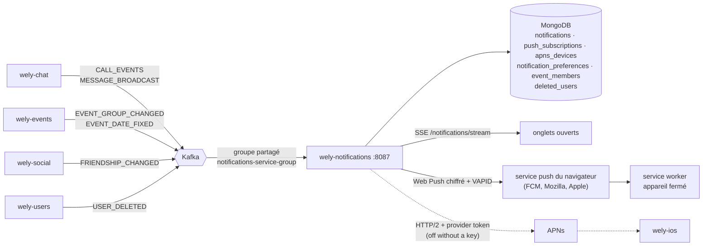

# wely-notifications

Service **centre de notifications et Web Push** de la plateforme [Wely Calendar](https://github.com/WelyLabs/wely-platform).

Il écoute ce qui se passe ailleurs — un appel qui sonne, un message, la date d'une sortie fixée, une demande d'ami — et en fait des notifications : enregistrées dans le centre de chaque utilisateur, poussées en direct aux onglets ouverts, et envoyées en **Web Push** à ses appareils quand l'application est fermée.

---

## Rôle

| | |
|---|---|
| **Port** | 8087 |
| **Préfixe HTTP** | `/notifications-service` (la gateway route `/api/v1/notifications-service/**`) |
| **Persistance** | MongoDB `notifications_db` |
| **Inputs** | Kafka: `CALL_EVENTS`, `MESSAGE_BROADCAST`, `EVENT_GROUP_CHANGED`, `EVENT_DATE_FIXED`, `FRIENDSHIP_CHANGED`, `USER_DELETED` |
| **Sorties** | REST, flux SSE, Web Push (RFC 8030/8291/8292), native iOS push (APNs, off until a key is configured) |

---

## Stack

Java 25 · Spring Boot 4 · WebFlux · Spring Cloud Stream (Kafka) · MongoDB réactif · Spring Security (JWT Keycloak) · MapStruct · springdoc · JDK seule pour la cryptographie Web Push et APNs · Reactor Netty HTTP/2 pour APNs

---

## Pourquoi un service dédié

| | |
|---|---|
| **Un seul endroit pour « prévenir quelqu'un »** | Les appels et les messages vivent dans `wely-chat`, les sorties dans `wely-events`, les amis dans `wely-social`. Aucun ne devrait savoir ce qu'est un appareil, une clé VAPID ou une préférence de notification. Ils publient ce qui s'est passé ; ce service décide qui prévenir et comment. |
| **Découplé par Kafka** | Aucun service métier n'appelle `wely-notifications`. Il consomme les topics existants : s'il tombe, les autres continuent, et il reprend où son groupe de consommateurs s'était arrêté. |
| **Le push est un détail d'infrastructure** | Le domaine produit un `PushMessage` (titre, texte, tag, urgence, durée de vie) ; le chiffrement et la signature sont dans un adaptateur, derrière le port `PushSender`. |

---

## Architecture



```
                        ┌──────────────────────────────────────────────────────┐
  Kafka (octets) ──────▶│ infrastructure/messaging                             │
                        │   CallEvents · Messages · EventGroups · EventDates   │
                        │   Friendships consumers  →  NotificationDrafts (FR)  │
                        │   UserDeleted consumer   →  AccountErasureService    │
                        └──────────────────────┬───────────────────────────────┘
  REST / SSE ──────────▶ application/rest      │ Notification (brouillon)
                        ┌──────────────────────▼───────────────────────────────┐
                        │ domain/                                              │
                        │   services/ NotificationService · PushService        │
                        │             EventMembershipService                   │
                        │             AccountErasureService        (POJO)      │
                        │   ports/    NotificationRepository · Subscription…   │
                        │             LiveNotifications · PushSender           │
                        │             DeletedUserMarkers · …                   │
                        └─────▲──────────────────▲───────────────────▲─────────┘
                              │                  │                   │
            ┌─────────────────┴───┐  ┌───────────┴──────────┐  ┌─────┴─────────────────┐
            │ infrastructure/     │  │ infrastructure/      │  │ infrastructure/push   │
            │ persistence (Mongo) │  │ realtime (Sinks)     │  │ WebPushAdapter        │
            └─────────────────────┘  └──────────────────────┘  │ WebPushEncryption     │
                                                               │ VapidSigner · P256    │
                                                               │ ApnsAdapter           │
                                                               │ ApnsTokenProvider     │
                                                               │ Es256                 │
                                                               └───────────────────────┘
```

`NotificationService.notify` :

0. drops the notification when its recipient or its actor is a **deleted account** (see [Account deletion](#account-deletion));
1. enregistre la notification, ou la **regroupe** avec la notification non lue de la même conversation ;
2. la pousse sur le flux SSE de son destinataire, suivie du nouveau compteur de non-lus ;
3. l'envoie en Web Push à chacun de ses appareils, si la catégorie est activée dans ses préférences ;
4. sends it through APNs to each of the recipient's iOS devices, under the same preference. Each channel is skipped on its own when it is not configured, and a failure on one never stops the other.

Un échec de push est journalisé et n'empêche jamais l'enregistrement. Un appareil auquel le service push répond **404 ou 410** est oublié ; an iOS device APNs answers **410**, or **400** `BadDeviceToken` / `Unregistered`, is forgotten too.

### Regroupement des messages

Un nouveau message dans une conversation qui a déjà une notification non lue la met à jour — compteur +1, dernier extrait, remontée en tête — au lieu d'en créer une autre : « Léa · 3 nouveaux messages ».

C'est une écriture atomique (`$inc` conditionnel sur le champ `openGroupKey`), puis une insertion s'il n'y a pas de groupe ouvert. Deux messages simultanés trouvent tous deux qu'aucun groupe n'est ouvert : un **index unique partiel** sur `{recipientId, openGroupKey}` laisse passer une seule insertion, l'autre se replie sur la mise à jour. Lire la notification efface `openGroupKey` : le message suivant rouvre un groupe. Le test d'intégration envoie vingt messages en parallèle et vérifie qu'il n'en reste qu'une notification, au compteur 20.

---

## API

Toutes les routes exigent un JWT ; l'utilisateur est **toujours** le claim `businessId`, jamais un paramètre.

| Méthode | Route | Corps | Réponse |
|---|---|---|---|
| `GET` | `/notifications?before=<instant ISO>&limit=30` | — | **200** `NotificationDTO[]`, plus récentes d'abord ; `limit` ramené entre 1 et 100 |
| `GET` | `/notifications/unread-count` | — | **200** `{ "count" }` |
| `POST` | `/notifications/read` | `{ "ids": [...] }` **ou** `{ "groupKey": "…" }` **ou** `{ "all": true }` | **204** ; plusieurs sélecteurs ou aucun → **400** `NTF-VAL-001` |
| `GET` | `/notifications/stream` | — | `text/event-stream` (see below); deleted account → **410** `NTF-BUS-002` |
| `GET` | `/push/public-key` | — | **200** `{ "publicKey" }`, vide si le push n'est pas configuré |
| `PUT` | `/push/subscriptions` | `{ "endpoint", "keys": { "p256dh", "auth" }, "label"? }` | **204**; same endpoint → replaced and moved to the caller; deleted account → **410** `NTF-BUS-002` |
| `DELETE` | `/push/subscriptions?endpoint=…` | — | **204** ; n'efface que l'appareil de l'appelant |
| `PUT` | `/push/apns-devices` | `{ "token": "<hex>", "environment": "SANDBOX" \| "PRODUCTION", "kind"?: "ALERT" \| "VOIP" }` (`kind` defaults to `ALERT`) | **204**; same token → replaced and moved to the caller; bad body → **400** `NTF-VAL-001`; token not hex 64–200 → **400** `NTF-VAL-002`; deleted account → **410** `NTF-BUS-002` |
| `DELETE` | `/push/apns-devices?token=<hex>` | — | **204**; only removes the caller's own device |
| `GET` | `/preferences` | — | **200** `{ "calls", "messages", "events", "friends" }` |
| `PUT` | `/preferences` | the four booleans | **200**, echoing what was saved; deleted account → **410** `NTF-BUS-002` |

`NotificationDTO` : `{ id, type, category, title, body, link, groupKey, count, actorId, createdAt, readAt }`. `link` est une route de l'application web (`/call/{id}`, `/chat/{id}`, `/event/{id}`, `/friends/{id}`).

### Flux SSE

```
event: unread
data: {"count":3}

event: notification
data: {"id":"…","type":"MESSAGE","category":"MESSAGES","title":"Léa · 2 nouveaux messages",…}

: keep-alive
```

Un événement `unread` part dès la connexion, puis à chaque changement. Un commentaire toutes les 20 s garde la connexion ouverte à travers les proxys, et l'en-tête `X-Accel-Buffering: no` empêche nginx de la mettre en tampon — comme le flux des sondages de `wely-events`.

The comments are merged with the updates as signals (`materialize` / `dematerialize`): when the user's channel is closed, the HTTP response ends instead of being held open forever by the comments alone. A deleted account gets **410** as `application/problem+json` before the stream opens; the content type is set explicitly, otherwise the `text/event-stream` route would encode the error as an event.

### Types et catégories

| Type | Catégorie | Source | Lien |
|---|---|---|---|
| `CALL_INCOMING` | `CALLS` | `CALL_EVENTS`, `RINGING` | `/call/{callId}` |
| `CALL_MISSED` | `CALLS` | `CALL_EVENTS`, `ENDED` au statut `MISSED`, pour tout membre autre que l'appelant | `/chat/{conversationId}` |
| `MESSAGE` | `MESSAGES` | `MESSAGE_BROADCAST`, `kind=NEW` et `type=TEXT` seulement | `/chat/{conversationId}` |
| `EVENT_DATE_FIXED` | `EVENTS` | `EVENT_DATE_FIXED` sans date précédente | `/event/{eventId}` |
| `EVENT_MOVED` | `EVENTS` | `EVENT_DATE_FIXED` avec une date précédente | `/event/{eventId}` |
| `FRIEND_REQUEST` | `FRIENDS` | `FRIENDSHIP_CHANGED`, `REQUESTED` | `/friends/{fromUserId}` |
| `FRIEND_ACCEPTED` | `FRIENDS` | `FRIENDSHIP_CHANGED`, `ACCEPTED` | `/friends/{fromUserId}` |

Le centre de notifications enregistre **toujours** ; seules les préférences de push dépendent de la catégorie. Toutes sont actives par défaut.

### OpenAPI

| | |
|---|---|
| Spec JSON | `http://localhost:8087/v3/api-docs` |
| Swagger UI | `http://localhost:8087/swagger-ui.html` |

Servies sans jeton : la gateway ne route que `/api/v1/<service>/**`, ces chemins restent internes.

---

## Web Push expliqué

Le navigateur s'abonne auprès de **son** service push (FCM pour Chrome, Mozilla pour Firefox, Apple pour Safari) avec la clé publique VAPID du serveur, et transmet à ce service-ci un `endpoint` et deux clés. Pour envoyer une notification, `wely-notifications` fait un `POST` sur cet endpoint. Deux RFC encadrent ce `POST`, et toutes deux sont implémentées avec la **JDK seule**, sans dépendance ajoutée :

### RFC 8291 — chiffrement du message

Le service push transporte le message sans pouvoir le lire.

1. Une paire de clés **P-256 éphémère** est tirée pour chaque envoi ; un **ECDH** avec la clé publique du navigateur (`p256dh`) donne un secret partagé.
2. **HKDF-SHA256** mélange ce secret avec le secret d'authentification du navigateur (`auth`), puis avec un sel aléatoire de 16 octets, pour dériver une clé **AES-128-GCM** et un nonce.
3. Le JSON est chiffré en un seul enregistrement `aes128gcm` (RFC 8188), suivi du délimiteur `0x02`. L'en-tête porte le sel, la taille d'enregistrement (4096) et la clé publique éphémère.

`WebPushEncryptionTest` reproduit **octet pour octet** le vecteur de test de l'annexe A de la RFC 8291, et déchiffre côté navigateur, avec un code indépendant, un message chiffré avec une clé aléatoire.

### RFC 8292 — VAPID

Le service push sait quel serveur envoie, sans compte ni clé d'API.

- Un JWT **ES256** — `aud` = origine de l'endpoint, `exp` = maintenant + 12 h, `sub` = un contact `mailto:` — signé par la clé privée VAPID. La signature DER de la JDK est convertie au format JOSE `R || S`.
- En-tête `Authorization: vapid t=<jwt>, k=<clé publique>`.

`VapidSignerTest` vérifie la signature avec la clé publique.

### Ce que reçoit le service worker

```json
{ "title": "Appel vidéo", "body": "On t'appelle sur Wely", "tag": "call-<id>",
  "link": "/call/<id>", "type": "CALL_INCOMING", "requireInteraction": true }
```

| | Appels | Messages | Autres |
|---|---|---|---|
| `tag` | `call-<callId>` | `conv-<conversationId>` | identifiant de la notification |
| `TTL` | 30 s | 24 h | 24 h |
| `Urgency` | `high` | `normal` | `normal` |

L'appel manqué porte **le même tag** que l'appel entrant : sur l'appareil, il remplace « Appel vidéo » au lieu de s'y ajouter. L'en-tête `Topic` est posé quand le tag est un topic valide (32 caractères base64url au plus).

---

## Native iOS push (APNs)

`wely-ios` (bundle id `com.welylabs.wely`) registers the device token it receives from `registerForRemoteNotifications()` with `PUT /push/apns-devices`, as lowercase or uppercase hex (stored lowercase), with `SANDBOX` for a development build and `PRODUCTION` for TestFlight and the App Store. The token is a capability to push to someone's phone: it is never logged.

**Off by default.** Without `APNS_TEAM_ID`, `APNS_KEY_ID` and `APNS_PRIVATE_KEY`, APNs is off: one warning at startup, registrations are still stored, nothing is sent, and Web Push and the notification center work as before. A malformed key also turns APNs off instead of failing the start. Turning it on needs a **paid Apple Developer account** and an **APNs auth key (.p8)** created under *Certificates, Identifiers & Profiles → Keys*; the key works for both environments.

What is sent, with the JDK and Reactor Netty alone:

- **Provider token**: an ES256 JWT, header `{alg: ES256, kid: <key id>}`, claims `{iss: <team id>, iat}`, signed with the .p8 key (PKCS#8 P-256, the same DER → JOSE conversion as VAPID). It is reused for 50 minutes: Apple refuses a token older than an hour and one refreshed more often than every 20 minutes.
- **Request**: `POST https://api.push.apple.com/3/device/<token>` (`api.sandbox.push.apple.com` for `SANDBOX`) over **HTTP/2** and TLS, within `app.push.timeout`. Headers `authorization: bearer <jwt>`, `apns-topic: <bundle id>`, `apns-push-type: alert`, `apns-priority: 10` for calls and `5` otherwise, `apns-expiration` = now + the message's TTL (30 s for a call, 24 h otherwise), `apns-collapse-id` = the tag, cut to 64 bytes.
- **Body**:

```json
{ "aps": { "alert": { "title": "Appel vidéo", "body": "On t'appelle sur Wely" }, "sound": "default",
           "thread-id": "call-<id>", "interruption-level": "time-sensitive" },
  "link": "/call/<id>", "type": "CALL_INCOMING" }
```

`interruption-level` is `time-sensitive` for calls (the app needs the *Time Sensitive Notifications* capability for it to break through Focus) and `active` otherwise. `link` and `type` are the same as in Web Push.

### VoIP pushes (PushKit) for incoming calls

An iPhone registers **two tokens**: its notification token with `kind` `ALERT` (or no `kind`), and its PushKit token with `kind` `VOIP`. Both live in `apns_devices`; a document stored before kinds existed reads as `ALERT`. A `VOIP` device never receives an alert.

- **A ringing call** (`CALL_INCOMING`) goes to the recipient's `VOIP` devices as a VoIP push, so the app rings through CallKit even when it is closed. If the recipient has at least one `VOIP` device, their `ALERT` devices get no alert for it (CallKit replaces it); without one, the alert is sent as before. Web Push to browsers is unchanged.
- **A call that ends** (`ENDED`, whatever its status: missed, declined or answered by others) sends a hang-up to the `VOIP` devices of every member who did not start it and is not among its participants, before the missed call is recorded.
- `CALL_MISSED` and every other type stay alert-only. With the **calls** preference off, neither push is sent. A token APNs answers **410** or **400** `BadDeviceToken` / `Unregistered` to is forgotten.
- Headers: `apns-push-type: voip`, `apns-topic: <bundle id>.voip`, `apns-priority: 10`, `apns-expiration` = now + 30 s, `apns-collapse-id: call-<callId>` (a hang-up replaces its ring when the ring is still waiting at APNs). The same `.p8` key signs both.

Ring, with no alert in `aps`: the app reports the call to CallKit from these fields alone, before calling any API.

```json
{ "aps": {}, "callId": "<id>", "caller": "Appel vidéo", "callerId": "<businessId>", "media": "VIDEO",
  "conversationId": "<id>", "link": "/call/<id>" }
```

`media` is `AUDIO` or `VIDEO`. `caller` is the notification's title: `CALL_EVENTS` carry user ids only, so the app should show it until it has resolved `callerId` to a name, then update the CallKit call.

Hang-up:

```json
{ "aps": {}, "callId": "<id>", "ended": true }
```

Since iOS 13, every VoIP push must be reported to CallKit: when a hang-up arrives for a call the app is not ringing, the app must report it and end it at once.

`ApnsAdapterTest` checks every header and the body against a stub exchange, and verifies the token's signature with the key pair's public half; `ApnsTokenProviderTest` checks the 50-minute cache.

---

## Événements consommés

Un seul groupe, **partagé** par toutes les répliques : `notifications-service-group`, démarrant au dernier offset pour un groupe nouveau — un premier déploiement ne rejoue pas l'historique. Les enregistrements arrivent en **octets** et sont lus un par un dans un `concatMap` : un enregistrement illisible ou un échec d'écriture est journalisé et abandonné seul, sans arrêter le flux (même modèle que les consommateurs de `wely-chat`).

Only `USER_DELETED` starts from the **earliest** offset: a deletion published before its binding first joined the group must still be erased.

| Topic (variable) | Charge utile | Effet |
|---|---|---|
| `CALL_EVENTS_TOPIC` | `{type, recipientId, actorId, call{id, conversationId, startedBy, media, status, …}}` | `RINGING` → `CALL_INCOMING` ; `ENDED` + `MISSED` → `CALL_MISSED` |
| `MESSAGE_BROADCAST_TOPIC` | `{senderId, senderName, receiverId, conversationId, content, photo, type, kind}` | `MESSAGE`, groupé par conversation ; extrait de 120 caractères, « 📷 Photo » pour une photo ; `SYSTEM` ignoré |
| `EVENT_GROUP_TOPIC` | `{eventId, title, organizerId, memberIds, version, deleted}` | met à jour la projection versionnée `event_members` ; une version plus ancienne est ignorée, un événement supprimé garde sa version et plus aucun membre |
| `EVENT_DATE_FIXED_TOPIC` | `{eventId, title, start, end, organizerId, previousStart, previousEnd}` | `EVENT_DATE_FIXED` ou `EVENT_MOVED` à chaque membre sauf l'organisateur, date en français dans `NOTICES_ZONE` ; événement inconnu de la projection → ignoré et journalisé |
| `FRIENDSHIP_TOPIC` | `{type: REQUESTED\|ACCEPTED, fromUserId, fromUserName, toUserId}` | `FRIEND_REQUEST` ou `FRIEND_ACCEPTED` à `toUserId` |
| `USER_DELETED_TOPIC` | `{userId, deletedAt}` (`deletedAt` missing from older records) | erases the account, see [Account deletion](#account-deletion) |

La projection `event_members` existe parce que `EVENT_DATE_FIXED` ne porte pas la liste des membres.
A deleted event keeps its version there, with no member **and no title**.

`USER_DELETED` is consumed by a `Function<Flux<Message<byte[]>>, Mono<Void>>`, not a `Consumer`: the binder subscribes to the result itself, with no manual `subscribe()`, and creates no output binding (the integration test asserts it). The other five consumers still subscribe themselves.

---

## Account deletion

When `wely-users` deletes an account, it publishes `USER_DELETED`. This service then erases what it holds about that account, in **idempotent** steps, since MongoDB gives no transaction here:

1. **marker** `deleted_users` `{_id: businessId, deletedAt, erasedAt}`, inserted if absent (the first `deletedAt` wins): every guard below is live before anything is deleted;
2. **closing the user's SSE streams**, in every tab;
3. **devices** (`push_subscriptions`, then `apns_devices`), first: nothing can be pushed while the rest is deleted;
4. **preferences** (`notification_preferences`);
5. **their own center**: the notifications they are the recipient of;
6. **the notifications they caused** for others (`actorId`, indexed): messages, calls, friend requests, event dates. Each affected recipient is sent their new unread count live;
7. `erasedAt`, last: an erasure cut short stays visibly unfinished.

A failure is retried five times with a growing delay (1 s, up to 30 s), then logged; the stream moves on to the next record. Replaying a record redoes deletions that no longer match anything.

**Reconciliation.** Kafka is the fast path, not the guarantee. `DeletedUsersReconciliationLoop` pages wely-users' tombstones (`GET /user-service/internal/deleted-users`, reached on the wely-users Service with `X-Internal-Secret: DELETED_USERS_READER_SECRET`, 500 per page) one minute after startup, then every 24 h. It runs the same erasure for every tombstone whose marker is missing or has no `erasedAt`, and again for every account deleted less than 48 h ago, which sweeps what a token still valid after the deletion may have written. A pass that fails, or that counts a failed erasure, is retried after 1 h; a pass still running after 24 h (a hung query) is cut and retried 1 h later. Each pass logs one summary line (tombstones, erased, failed). This repairs a record lost by a pod stopping mid-way, a record skipped after its retries, a new consumer group and a restored database; erasure never depends on how long Kafka keeps `USER_DELETED`.

**Guards.** The marker is permanent; it holds only the `businessId`, which the other services already keep as a pseudonym.

- `notify` creates nothing for a deleted recipient or actor: a message, a call or a friend request arriving late on Kafka recreates nothing.
- Every write checks the marker **before** and again **after** writing: if the erasure started in between, what was just written is removed. `notify` then neither streams nor pushes the notification; `PUT /push/subscriptions` and `PUT /preferences` delete the device or the preferences again and answer **410**. If the second check sees no marker, the marker and the erasure's deletions come after the write and win.
- `PUT /push/subscriptions`, `PUT /preferences` and `GET /notifications/stream` answer **410** `NTF-BUS-002` to a still-valid token of a deleted account. Reads and deletions stay open: they recreate nothing.
- A stream reads the marker again once it has joined the user's channel, and closes the channel if the account is deleted: an erasure that closed the channel just before the join cannot leave a stream open.

`event_members` is not edited locally: `wely-events` republishes `EVENT_GROUP_CHANGED` without the deleted account for upcoming events, and the versioned projection follows. Past events keep the id as a pseudonym; `notify` drops the notices that would be addressed to it.

**Residual copies**, out of this service's reach:

| Copy | Lifetime |
|---|---|
| Messages already handed to the push services (FCM, Mozilla, Apple, APNs) | 24 h at most (30 s for a call) |
| Notifications already shown by the device's system | until the user dismisses them |
| Kafka records of the consumed topics | each topic's retention, set in `wely-gitops-infra` |
| Pod logs (`businessId`) | until the logs rotate |

---

## Gestion des erreurs

| Code | HTTP | Signification |
|---|---|---|
| `NTF-BUS-001` | 400 | Abonnement push inutilisable : endpoint non `https`, `p256dh` qui n'est pas un point P-256, `auth` qui ne fait pas 16 octets |
| `NTF-BUS-002` | 410 | Account deleted: push subscription, preferences or stream refused |
| `NTF-TEC-001` | 502 | MongoDB injoignable |
| `NTF-TEC-002` | 502 | wely-users' list of deleted accounts unreadable or not configured (reconciliation only, never sent to a client) |
| `NTF-VAL-001` | 400 | Validation du corps JSON, détail par champ |
| `NTF-VAL-002` | 400 | APNs device token not hex, or not 64 to 200 characters |
| `NTF-REQ-000` | *repris* | Chemin inconnu, méthode non autorisée, paramètre manquant |
| `NTF-TEC-000` | 500 | Erreur inattendue |

Toutes les réponses d'erreur sont des `ProblemDetail` (RFC 7807), avec `code` et `timestamp`.

---

## Profils Spring

| Profil | Usage |
|---|---|
| *(aucun)* / `prod` | `application.properties` — tout vient de l'environnement |
| `dev` | MongoDB, Kafka et Keycloak sur `localhost` |

---

## Configuration

| Variable | Défaut | Description |
|---|---|---|
| `MONGODB_URI` | — (requis) | URI MongoDB (`spring.mongodb.uri`, la clé Boot 4) |
| `KAFKA_BOOTSTRAP_SERVER` | — (requis) | Brokers Kafka |
| `KEYCLOAK_ISSUER_URI` | — (requis) | Émetteur public des jetons |
| `KEYCLOAK_INTERNAL_JWK_SET_URI` | — (requis) | Clés de signature, par le Service Keycloak interne |
| `VAPID_PUBLIC_KEY` | vide | Point P-256 non compressé (65 octets), base64url |
| `VAPID_PRIVATE_KEY` | vide | Scalaire P-256 (32 octets), base64url |
| `VAPID_SUBJECT` | vide | Contact pour les services push, `mailto:…` |
| `APNS_TEAM_ID` | empty | Apple Developer team id, the provider token's issuer |
| `APNS_KEY_ID` | empty | Id of the APNs auth key (10 characters) |
| `APNS_PRIVATE_KEY` | empty | Content of the `.p8` file, PKCS#8 PEM; armor, newlines and escaped `\n` all accepted |
| `APNS_BUNDLE_ID` | `com.welylabs.wely` | The iOS app, sent as `apns-topic` |
| `CALL_EVENTS_TOPIC` | `CALL_EVENTS` | Événements d'appel de `wely-chat` |
| `MESSAGE_BROADCAST_TOPIC` | `MESSAGE_BROADCAST` | Messages de `wely-chat` |
| `EVENT_GROUP_TOPIC` | `EVENT_GROUP_CHANGED` | Membres des sorties, de `wely-events` |
| `EVENT_DATE_FIXED_TOPIC` | `EVENT_DATE_FIXED` | Dates fixées ou décalées, de `wely-events` |
| `FRIENDSHIP_TOPIC` | `FRIENDSHIP_CHANGED` | Demandes d'ami, de `wely-social` |
| `USER_DELETED_TOPIC` | `USER_DELETED` | Deleted accounts, from `wely-users` |
| `NOTICES_ZONE` | `Europe/Paris` | Fuseau des dates écrites dans les notifications |
| `NOTIFICATIONS_CONSUMERS_ENABLED` | `true` | Turns off the six Kafka consumers |
| `USERS_API_URL` | empty (`http://localhost:8082` in `dev`) | wely-users' in-cluster URL, read by the reconciliation. Empty: the service starts, each pass fails with `NTF-TEC-002` |
| `DELETED_USERS_READER_SECRET` | empty | Reader secret of wely-users' deleted-accounts list, sent in `X-Internal-Secret`. Empty: same effect as above |
| `ACCOUNT_ERASURE_RECONCILIATION_ENABLED` | `true` | `false` stops the reconciliation loop |

**Sans clés VAPID, le push est désactivé** — un avertissement au démarrage, `GET /push/public-key` rend une chaîne vide — mais le centre de notifications et le flux SSE fonctionnent. Une paire de clés malformée désactive aussi le push au lieu d'empêcher le démarrage. **Without the three `APNS_*` secrets, native iOS push is off** the same way, independently of Web Push.

Générer une paire de clés :

```bash
openssl ecparam -name prime256v1 -genkey -noout -out vapid.pem
openssl ec -in vapid.pem -outform DER | tail -c +8 | head -c 32 | base64 | tr '/+' '_-' | tr -d '='   # privée
openssl ec -in vapid.pem -pubout -outform DER | tail -c 65 | base64 | tr '/+' '_-' | tr -d '='       # publique
```

---

## Démarrage

```bash
./mvnw spring-boot:run -Dspring-boot.run.profiles=dev
```

Pour lancer **toute la plateforme** sur un Kubernetes local :

```bash
git clone https://github.com/WelyLabs/wely-gitops-infra && cd wely-gitops-infra
kubectl apply -k overlays/local --server-side
```

---

## Tests

```bash
./mvnw test -Dtest='!*IntegrationTest' -DfailIfNoSpecifiedTests=false   # unitaires seuls
./mvnw verify -Dintegration.tests=true                                   # + Testcontainers, couverture ≥ 80 %
```

Les classes `*IntegrationTest` démarrent un vrai MongoDB et un vrai Kafka (Testcontainers) : regroupement atomique sous concurrence, index partiel, pagination et filtrage par destinataire, projection versionnée, abonnements, et un aller-retour Kafka → MongoDB précédé d'un enregistrement illisible. Elles tournent en CI (`CI=true`) ou avec `-Dintegration.tests=true`, et exigent un démon Docker.

They also cover the deleted-account markers, deletions by actor, a late friend request from a deleted account, and a full `USER_DELETED` erasure on a topic the binder may not create, with no output binding.

> **Note build :** ce service produit dans `target-maven/` et non `target/` en local.

---

## Limites connues

- **Une seule réplique.** Les consommateurs Kafka partagent un groupe, ils passeraient à l'échelle ; mais le flux SSE est un `Sink` **en mémoire** par utilisateur : une notification enregistrée par un pod n'atteint pas les onglets connectés à un autre. Plusieurs répliques demanderaient une diffusion entre pods (un topic à un groupe par pod, comme `wely-chat` pour ses messages).
- **Closing a deleted account's streams is per pod.** Only the streams open on the pod that reads `USER_DELETED` are closed; with several replicas, a stream open on another pod would stay open.
- **Pas de nom pour l'appelant.** Les événements d'appel ne portent que des identifiants et ce service ne tient pas d'annuaire : la notification dit « Appel vidéo — On t'appelle sur Wely », sans dire qui. Les messages et les demandes d'ami, eux, portent le nom de l'émetteur.
- **Au plus une fois, sans outbox côté producteurs.** Un enregistrement en échec est abandonné après journalisation (avec trois nouvelles tentatives pour la projection des membres). Une notification manquée n'est pas rejouée.
- **Erasure catch-up is daily.** A `USER_DELETED` still failing after five attempts, or lost to a pod stopping mid-way, leaves a marker without `erasedAt` (or no marker at all) until the next reconciliation pass: at most 24 h, plus 1 h per failed pass.
- **Pas de purge.** Les notifications lues restent en base ; un index TTL sur `readAt` serait la prochaine étape.
- **Un seul fuseau horaire** pour les dates écrites, comme les notices de `wely-chat`.
